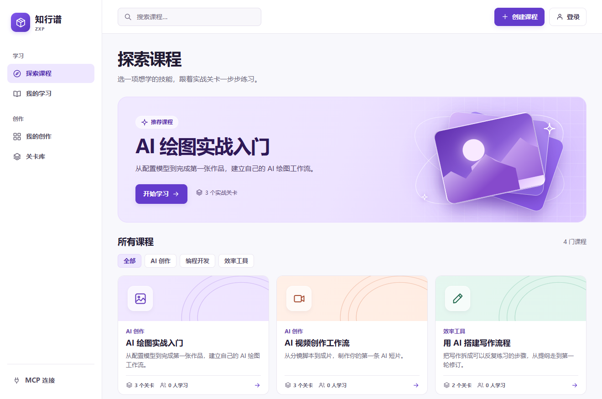
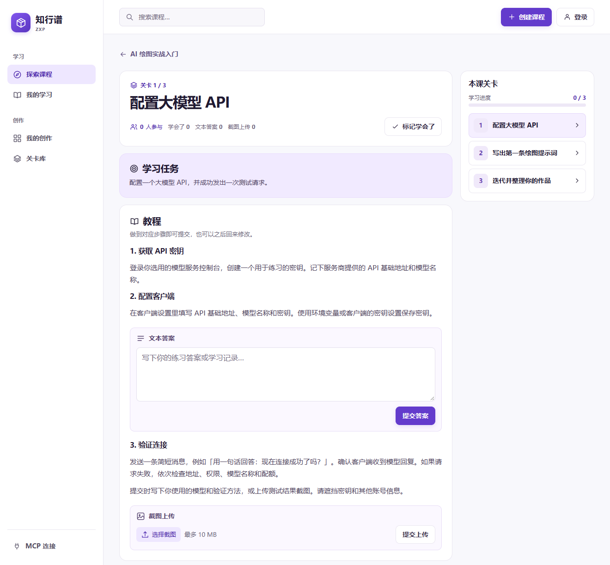

<div align="center">
  
  <h1>知行谱 · ZXP</h1>
  <p><strong>用可复用的关卡编排实战课程</strong></p>
  <p>编写教程、穿插练习，在每一步提交答案、截图或作品。</p>
  <p>
    <a href="https://skill-workshop-learning.mixedbobcat1.chatgpt.site">私人试用</a>
    · <a href="#快速开始">快速开始</a>
    · <a href="#创建课程">创建课程</a>
    · <a href="#课程许愿">课程许愿</a>
    · <a href="#账号与管理">账号与管理</a>
    · <a href="#mcp-接入">MCP 接入</a>
    · <a href="#参与开发">参与开发</a>
  </p>
</div>



## 一个关卡，多门课程

| 编排课程 | 边学边交 | 复用进度 |
| :--- | :--- | :--- |
| 从关卡库引用现有关卡，也可以创建新关卡。 | 把答案框、截图和文件上传放到教程中的对应步骤。 | 同一账号在多门课里学习同一关卡时，共用学会状态和提交记录。 |

<details>
<summary>查看教程内的提交界面</summary>



</details>

## 快速开始

需要 **Node.js 22.12+** 和 npm。

```sh
git clone https://github.com/glwhappen/zxp.git
cd zxp
npm ci
npm run db:migrate
npm run dev
```

打开 [http://127.0.0.1:8787](http://127.0.0.1:8787) 并注册本地账号。首次打开时，知行谱会载入四门示例课程。

> [!TIP]
> 在「AI 绘图实战入门」的「配置大模型 API」关卡提交答案或标记学会，再去「AI 视频创作工作流」打开同一关卡，查看同步后的学习记录。

本地数据保存在 `.wrangler/state/`。停止服务按 Ctrl+C。需要换端口时，可以运行 `npm run dev -- --port 8788`。

## 创建课程

1. 在「创建课程」填写课程资料，添加关卡并调整顺序。
2. 新关卡使用 Markdown 编写教程。在练习说明后点击「插入文本答案」「插入截图上传」或「插入文件上传」，开启对应的提交方式。
3. 保存课程。发布前，将课程内的关卡设为公开。

<details>
<summary>查看可见性、提交与学习记录规则</summary>

| 项目 | 规则 |
| --- | --- |
| **可见性** | 课程与关卡创建时默认私有。公开课程出现在探索页，公开关卡可供其他作者引用。 |
| **编辑权限** | 仅关卡作者可以修改原关卡。公开课程或其他作者仍在引用时，需先解除相关引用，才能把关卡改为私有。 |
| **提交位置** | 每种提交方式显示一次。有手动插入的位置时，其他已开启的提交框放在教程末尾。未手动插入时，按教程步骤或段落自动安排。 |
| **提交与进度** | 答案、截图和文件各保留最新一份，可随时覆盖。网页单个附件最多 10 MB。标记「学会了」是独立操作，课程进度按学会的关卡计算。 |
| **人数与隐私** | 统计按账号去重，参与人数包含标记学会或提交过作业的用户。提交内容与附件仅本人可见，其他用户看到聚合人数。 |

</details>

## 课程许愿

在「课程许愿」里写下希望开设的课程、想掌握的技能和偏好的学习方式。进入站点的人都可以浏览讨论，登录后可以发布、回复或关联公开课程。

许愿者可以对每门关联课程点赞、点踩或撤销反馈，并在需求解决后标记完结。需求有变化时可以重新打开。关联课程设为私有或下架后，会从许愿详情里隐藏。

## 账号与管理

管理员登录后，可从左侧导航进入 `/admin`，查看账号和统计、下架或恢复课程、启用或关闭登录方式。下架会隐藏课程，关卡库中单独公开的关卡仍可引用。

| 登录方式 | 默认行为 |
| --- | --- |
| ChatGPT | Sites 托管版本默认开启，识别已有的 ChatGPT 账号。 |
| 账号密码 | 默认开启，用户可注册并用用户名和密码登录。可从「我的账号 → 切换登录方式」进入。 |
| OIDC | 配置身份服务后可开启。首次登录会按该服务的 Issuer 和 Subject 建立账号。 |

三种登录身份各自对应一个账号。已有课程与学习记录会留在原账号，更换登录方式后可从「我的账号」切回。

### 接入 OIDC

1. 在身份服务中创建 Web 应用，使用 Authorization Code Flow，并支持 PKCE S256。把 `<知行谱站点地址>/api/auth/oidc/callback` 加入回调地址。默认请求 `openid profile`。
2. 配置 [环境变量模板](./.env.example) 中的 `OIDC_ISSUER`、`OIDC_CLIENT_ID` 和 `OIDC_CLIENT_SECRET`。`OIDC_ISSUER` 应与发现文档中的 `issuer` 一致。密钥写入部署环境的 Secret，本地开发时将模板复制为 `.dev.vars`。
3. 登入管理后台并开启 OIDC。用身份服务登录一次，确认返回站点后，在「我的账号」里可以查看自己的 OIDC Subject。
4. 如果要**只用 OIDC**，先把身份服务中管理员的 Subject 配到 `ZXP_ADMIN_OIDC_SUB`，确认该账号能打开后台，再关闭 ChatGPT 和账号密码。也可用部署变量 `ZXP_LOGIN_METHODS=oidc` 固定登录方式。

客户端认证默认用 `client_secret_basic`。提供方要求在表单里提交密钥时，将 `OIDC_CLIENT_AUTH` 设为 `client_secret_post`。支持仅使用 PKCE 的公开客户端时可设为 `none`。可选的 `OIDC_REDIRECT_URI` 用于固定登录所在的站点地址。

管理员身份由部署配置指定。除了 OIDC Subject，还可配置 Sites 验证的 ChatGPT 邮箱 `ZXP_ADMIN_CHATGPT_EMAIL`，或者本地账号 ID `ZXP_ADMIN_LOCAL_USER_ID`。本地账号 ID 可在注册登录后从「我的账号」复制。

Sites 的私人访问限制在应用登录页面前生效。要让其他人在进入站点时只用你的身份服务，站点入口也须允许他们访问，例如用可匿名到达的 Sites 入口，或部署在由你控制入口的环境。应用的登录开关控制进入页面后的账号方式。

## MCP 接入

| 环境 | 连接方式 |
| --- | --- |
| **托管站点** | 在 ChatGPT 或 Codex 中连接 Sites 发布时生成的个人插件。助手以连接账号访问课程与关卡，新课程可在网页的「我的创作」查看。 |
| **本地开发** | 登录后在「MCP 连接」生成令牌。使用无状态 Streamable HTTP 连接 `http://127.0.0.1:8787/mcp`，请求头为 `Authorization: Bearer <令牌>`。轮换后旧令牌立即失效。 |

### 创建一门引用现有关卡的课程

`stageIds` 决定关卡顺序。新关卡可以先用 `stage_create` 创建，再把返回的 ID 加入数组。

```json
{
  "name": "course_create",
  "arguments": {
    "title": "AI 视频练习",
    "description": "先验证模型连接，再完成短片。",
    "category": "AI 创作",
    "visibility": "private",
    "stageIds": ["api-setup", "video-shots"]
  }
}
```

<details>
<summary>查看工具清单与参数说明</summary>

| 工具 | 用途 |
| --- | --- |
| `course_list`、`course_get` | 浏览公开、自己的或已加入的课程，查看关卡顺序和进度 |
| `course_create`、`course_update`、`course_join` | 创建、更新或加入课程 |
| `stage_list`、`stage_get` | 查找可引用关卡，读取教程、统计和自己的提交 |
| `stage_create`、`stage_update` | 创建或更新独立关卡 |
| `stage_mark_learned`、`stage_submit_answer`、`stage_submit_file` | 切换学会状态，提交答案或附件 |
| `wish_list`、`wish_get`、`wish_replies` | 浏览许愿、关联课程和回复 |
| `wish_create`、`wish_reply`、`wish_link_course` | 发布许愿、回复和关联公开课程 |
| `wish_rate_course`、`wish_set_status` | 由许愿者评价关联课程、完结或重新打开 |

- 更新课程或关卡时，先读取记录，再传入完整表单。
- 在 Markdown 教程的独立段落插入 `{{submit:answer}}`、`{{submit:screenshot}}` 或 `{{submit:file}}`，并在 `methods` 中开启对应方式。
- 上传使用标准 Base64，单文件编码前最多 2 MiB。
- 支持 `server/discover` 和早期客户端使用的 `initialize`。协议见 [MCP Streamable HTTP](https://modelcontextprotocol.io/specification/2026-07-28/basic/transports/streamable-http)。

</details>

## 参与开发

从 `main` 建立功能分支。提交 Pull Request 时，说明用户能看到的变化、验证步骤和新增迁移的应用方式。

```sh
npm test
npm run build
```

| 目录 | 内容 |
| --- | --- |
| [`src/client/`](./src/client) | 探索、学习、创作与 MCP 连接页面。教程由 Marked 解析，经 DOMPurify 处理后渲染。 |
| [`src/server/`](./src/server) | HTTP 入口 `worker.js` 和 MCP 入口 `mcp.js` 共用权限、校验与写入逻辑。 |
| [`drizzle/`](./drizzle) | D1 迁移。课程与关卡通过 `course_stages` 关联，`progress` 和 `submissions` 保存个人记录。 |
| [`scripts/`](./scripts) | 用 esbuild 构建浏览器资源与 Worker，通过 Wrangler 运行本地开发环境。 |
| [`test/`](./test) | 覆盖教程内提交位置、跨课程进度、账号隔离、附件替换、人数去重和 MCP 创建课程。 |

修改业务规则时，优先更新网页与 MCP 共用的模块。改动数据结构时新增迁移并追加迁移日志。验证涉及权限的变更时，至少用两个账号检查。

<details>
<summary>查看本地与托管环境的配置差异</summary>

本地账号、D1 和 R2 由 Wrangler 提供，仓库中的数据库 ID 是本地模拟用的占位符。`npm run build` 生成 `dist/server/index.js`，托管版本使用 Sites 提供的登录身份、D1 和 R2。迁移到其他托管环境时，需接入可信身份校验。

账号凭据、个人令牌、上传文件和构建产物留在各自的运行环境中。

</details>
